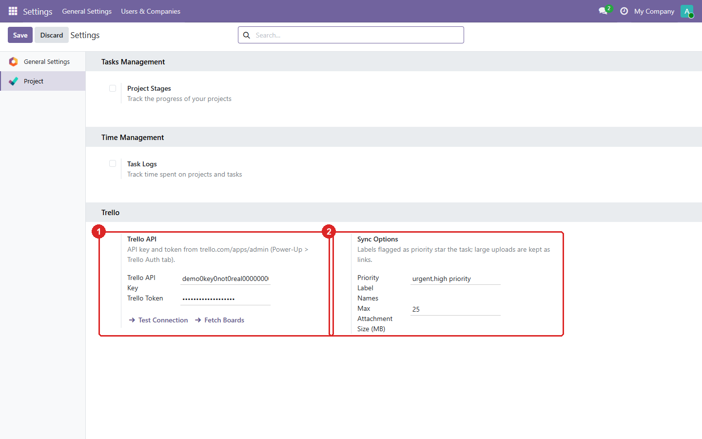
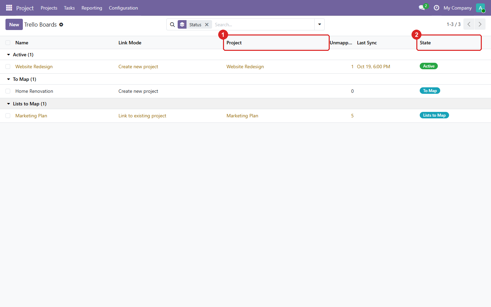
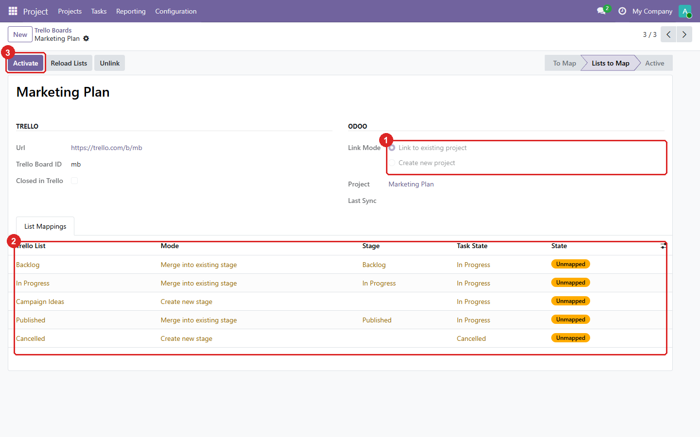
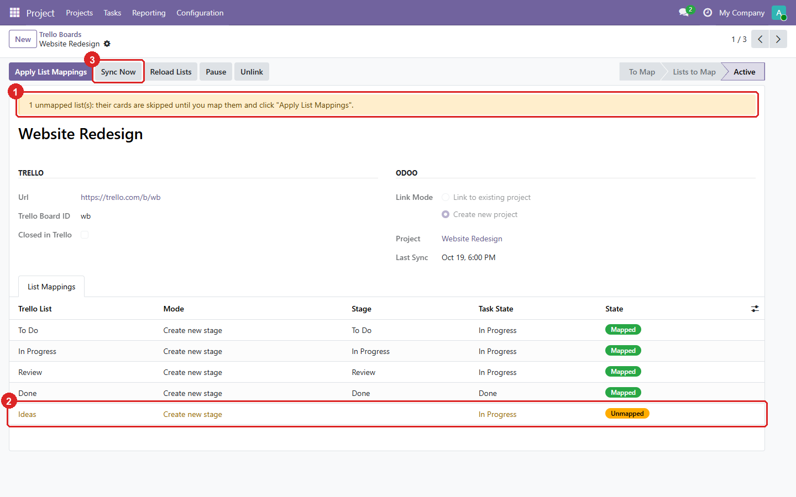
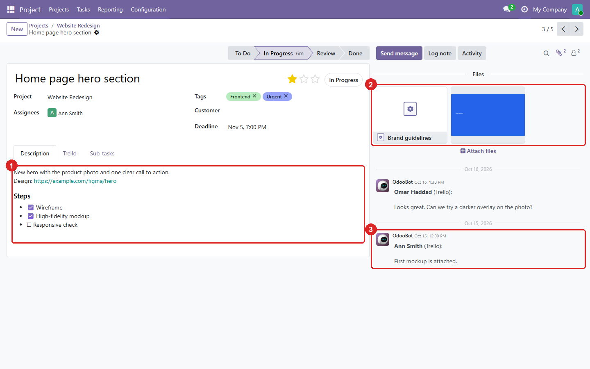
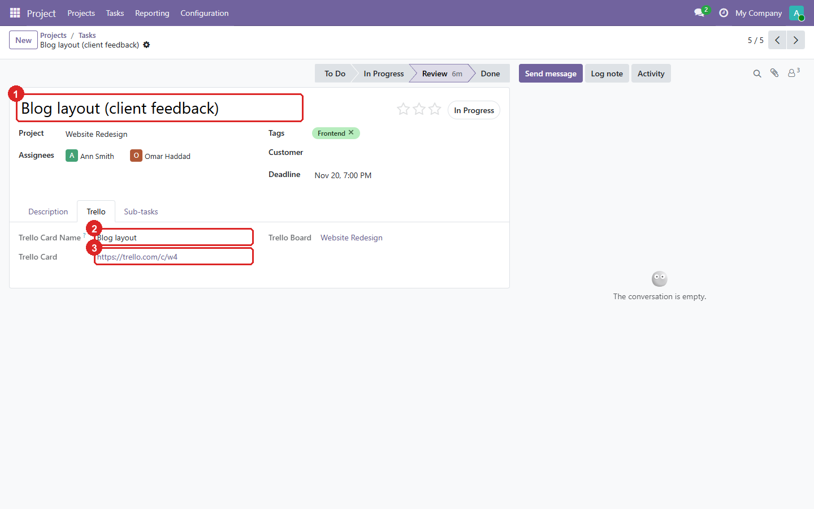

# Trello

[](https://github.com/yakhras/Odoo-Trello/actions/workflows/tests.yml)

An Odoo module that imports your [Trello](https://trello.com) boards into Odoo Projects through the Trello REST API. Lists become stages, cards become tasks, and comments, checklists and attachments come along. You decide, board by board and list by list, where everything lands, so nothing is duplicated.

The sync runs **one way, from Trello to Odoo**. It polls Trello on a schedule, so it also works on an Odoo server that the internet can't reach (no webhooks needed).

## Features
- **Board → Project, with a control step.** Each board is either linked to an **existing project** or used to **create a new one**. Nothing syncs until you confirm. Odoo refuses:
  - a project that is already linked to another board
  - a new project when one with the same name already exists
- **List → Stage, with a control step.** Each Trello list is either **merged into an existing stage** (matched by name by default) or used to **create a new stage**. Several lists can merge into one stage.
  - A list added in Trello later shows up as **Unmapped**. Its cards are skipped, and a warning stays on the board, until you map the list.
- **Cards → Tasks:**
  - title
  - description, with checklists shown as ☑ / ☐
  - deadline
  - labels → tags
  - members → assignees, through a member ↔ user mapping
- **Priority:** labels named in the **Priority label names** setting (default `urgent, high priority`) flag the task as high priority (starred). You can also flag any label by hand.
- **State:**
  - a card whose due date is marked complete becomes **Done**
  - otherwise the task takes the state set on its list's mapping (**Done** lists are pre-filled from names like "Done" and "Complete")
  - an archived card becomes an archived task
- **Comments** become notes in the task's chatter, with the author and date. Each comment is imported only once.
- **Attachments:**
  - uploaded images, audio, PDFs and other files are copied into Odoo
  - link attachments are kept as links
  - files larger than the **Max attachment size** setting (default 25 MB) stay as links to Trello
- **Your Odoo edits are kept.** A task stays linked to its card even when you rename it or move it to another project. A sync only overwrites a field that changed in Trello since the last sync. The **Trello** tab on the task shows the card's current name when it differs from the task title.
- **Nothing is ever deleted:**
  - a card deleted in Trello archives its task
  - **Unlink** detaches a board but keeps the project and its tasks

## Requirements
- Odoo 19.0 (Community or Enterprise). It depends only on `project` and `mail`.
- The Python package `requests`, which comes with Odoo. If the optional package `markdown` is installed, card descriptions keep their formatting; without it they are imported as plain text with clickable links.
- A Trello account, and an API key + token (see Configuration).
- Outgoing HTTPS from the Odoo server to `api.trello.com` and `trello.com`.

## Installation
1. Clone the repository on the `19.0` branch next to your other addons:
   ```
   git clone -b 19.0 https://github.com/yakhras/Odoo-Trello.git
   ```
2. Add the clone's folder to `addons_path` and restart Odoo.
3. Go to Apps, update the apps list, and install **Trello**.

## Configuration
1. **Create a Power-Up** in Trello, which is where API keys come from: go to [trello.com/power-ups/admin](https://trello.com/power-ups/admin) and click **New**.
   - Any workspace you belong to works, for example your own one. The token below still sees boards from every workspace you are a member of.
   - Leave the **Iframe connector URL** empty, and turn on no capabilities. The module talks to the REST API only.
2. In the Power-Up, open the **Trello Auth** tab and click **Generate a new API Key**.
   - Ignore the **OAuth 2.0** tab; this module doesn't use it.
3. **Create a read-only token** that doesn't expire. Open this URL with your key in place of `YOUR_KEY`, then click **Allow**:
   ```
   https://trello.com/1/authorize?expiration=never&scope=read&response_type=token&key=YOUR_KEY
   ```
   Keep the token secret. You can revoke it at any time under **Applications** in your Trello account settings.
4. In Odoo, go to **Project → Configuration → Settings → Trello**:
   - enter the key and the token, and save
   - click **Test Connection**; it should show your Trello name
   - optionally set **Priority Label Names** and **Max Attachment Size (MB)**

## Usage
1. In Settings, click **Fetch Boards**. Every board you are a member of appears under **Project → Configuration → Trello → Boards**, in the state **To Map**. Fetching again never creates duplicates.
2. Open a board. Choose **Link to existing project** (the module pre-fills a project with the same name, if there is one) or **Create new project**, then click **Confirm**.
3. On the **List Mappings** tab, choose **Merge into existing stage** or **Create new stage** for each list, plus the task state for its cards. Then click **Activate**.
4. Click **Sync Now**, or wait for the scheduled action **Trello: Sync active boards**, which runs every 15 minutes.
5. Under **Trello → Members**, link each Trello member to an Odoo user so tasks get assignees. Members are matched by name automatically when possible.

Other buttons on the board:
- **Pause** / **Resume** stop and restart the sync.
- **Reload Lists** reads the board's lists again.
- **Apply List Mappings** applies the mappings for lists added later.
- **Unlink** detaches the board. The project and tasks stay.

The screenshots below use **generated demo data**, not real boards.

**Settings:** the API key and the token, which is masked (1), with **Test Connection** and **Fetch Boards**. The priority label names and the maximum attachment size (2).



**Boards:** every fetched board with its project (1) and status (2). Nothing syncs until a board is **Active**.



**Mapping a board:** link to an existing project or create a new one (1). Then, for each list, merge it into an existing stage or create a new one, and choose the task state for its cards (2). **Activate** (3) applies the mappings.



**An active board:** a list added in Trello later raises a warning (1) and waits as **Unmapped** (2), and its cards are skipped until you map it. **Sync Now** (3) runs the sync right away.



**The imported tasks:** lists became stages, labels became tags, and the **Urgent** label gives the star (1).


**One task:** the card's description with its checklist (1), the attachments: an uploaded image and a link (2), and the Trello comments as notes, with their author and date (3).



**The Trello tab:** this task was renamed in Odoo (1), so the tab shows the card's own name (2) and links to the card (3). The task stays linked to its card, so the sync updates it instead of creating a duplicate.



Trello allows 100 requests per 10 seconds per token. A sync uses about 3 requests per board, and the module waits and retries when Trello answers with a rate-limit error.

## Tests
```
odoo -d <throwaway_db> -i trello --test-tags /trello --stop-after-init
```
The tests mock every Trello call, so they need no network and no key. GitHub Actions runs them on every push.

## Author
[Yaser Akhras](https://yaserakhras.com) · [@yakhras](https://github.com/yakhras)

## License
AGPL-3.0 or later. See [LICENSE](LICENSE).
